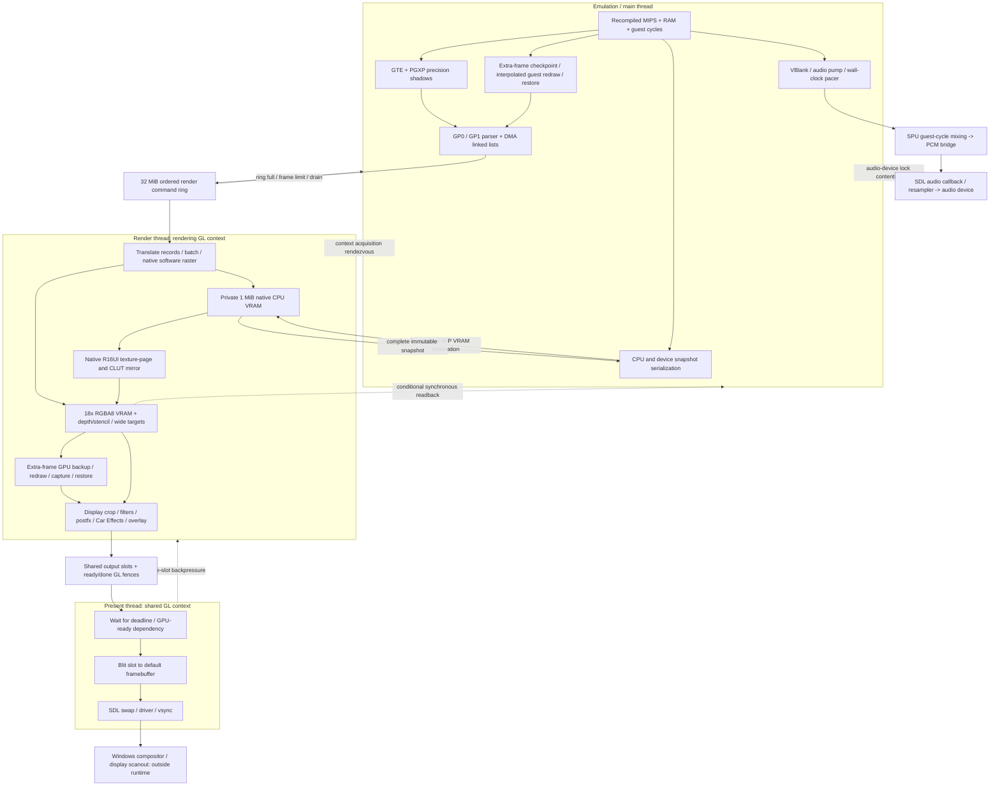

# R4 frame pipeline: historical audit and phase-4 update

**Phase-4 topic update (2026-10-29):** R4 FPS now selects the generic retained-packet presenter. Guest interpolation, field lists, private workers and their title adapters are removed. Car Effects metadata is captured into packets and sampled on the render owner. The detailed audit below describes the earlier pipeline; its extra-pass and worker sections are historical. Current implementation and acceptance results: [Phase-4 status](FRAME_INTERPOLATION_STATUS.md). Shared transactional APIs still serve separate netplay local-view/stereo features; FPS does not invoke them.

Code audit, 2026-10-28. This is a map for design review, not a proposed replacement architecture or a new benchmark. No builds, game runs, or measurements were performed for this document.

The audited R4 baseline is `805eadb3` on `fix/race-real-time`. Framework references describe the local `fix/queued-vram-snapshot` branch at `1efd81f9`, including `a1af76d0`. These two commits are unmerged. The latter commit is WIP: deferred snapshot ordering has fixture coverage, but integrated game validation was interrupted. The R4 gitlink has deliberately not been advanced. File/line links below therefore refer to this local framework checkout; a checkout of the committed R4 gitlink will not contain all WIP lines.

Scope: the requested 18x, 60 FPS race, Rewind, Car Effects and full PGXP configuration, with the native-wide renderer and HD texture support used by the existing performance runs. This is not the fresh-default configuration of `805eadb3`. Conditional paths are identified rather than counted as simultaneously active.

## 1. Ownership and the full path

There is one authoritative guest machine. Its recompiled code, device scheduling, GP0 parser, SPU simulation and ordinary snapshot serialization run on the emulation/main thread. The render thread consumes an ordered backend command stream; it owns the rendering GL context and, in HD-native-authority mode, a private native CPU VRAM image. The present thread owns a different shared GL context and swaps completed images. SDL's audio callback consumes host PCM; it does not run the guest SPU.

Optional private draw workers execute guest drawing code against copied machine contexts. They produce command streams, not GL submissions. Car Effects currently prevents R4 from selecting that worker path. Serial extra guest drawing can nevertheless queue its GL work to the render thread: “serial extra frame” does **not** mean all of its GL calls execute on the emulation thread.

Sources: [render ownership](../psxrecomp/runtime/src/gpu_gl_renderer.c#L475), [render consumer](../psxrecomp/runtime/src/render_thread.c#L234), [present consumer](../psxrecomp/runtime/src/present_thread.c#L105), [private contexts](../psxrecomp/runtime/src/psx_exec_ctx.c#L185), [R4 worker exclusion](../src/mods/r4_race_hud.cpp#L814), [audio callback](../psxrecomp/runtime/src/main.cpp#L3056).

Solid arrows carry work/data. Dotted arrows identify backpressure or rendezvous; they do not imply that every arrow is exercised every frame. A GL server-side fence wait orders GPU work and is different from a CPU condition-variable wait.

## 2. Size ledger at 18x

These are logical payload/storage sizes, not driver residency, bandwidth measurements, or a total VRAM allocation. MiB means 1,048,576 bytes. Multisampling is not implied: the cited ordinary targets use single-sample storage.

| Object | Pixels / elements | Bytes and scaling |
|---|---:|---|
| Guest native VRAM, public CPU image | 1024 x 512 = 524,288 words | 1,048,576 bytes (1 MiB), independent of scale |
| Render-owner native CPU image | Same | Another 1 MiB; published/copied at ownership boundaries |
| Native GL texture/CLUT mirror, R16UI | Same | 1 MiB; **not** 18x |
| Full enhanced VRAM, RGBA8 | 18432 x 9216 = 169,869,312 | 679,477,248 bytes (648 MiB) |
| Full enhanced depth/stencil, D24S8 | Same | Another 648 MiB; color + depth = 1,296 MiB |
| 320 x 240 display rectangle at 18x | 5760 x 4320 = 24,883,200 | 99,532,800 bytes (94.921875 MiB) per RGBA8 or D24S8 surface |
| Native-wide target | `wide_width * 18` by `512 * 18` | `wide_width * 512 * 324 * 4` bytes per color or depth target; active display band can be smaller |
| 8K drawable / output slot color | 7680 x 4320 = 33,177,600 | 132,710,400 bytes (126.5625 MiB); color + D24S8 = 253.125 MiB per allocated slot |
| Full 8K RGBA16F postfx surface | 33,177,600 | 265,420,800 bytes (253.125 MiB); half-width/half-height is one quarter of this |
| Native upload rectangle `w*h` | `w*h` | `2wh` native bytes, `4wh` converted RGBA staging bytes; scaled destination covers up to `324wh` pixels |
| GPU copy rectangle `w*h` at scale | `324wh` | `1296wh` bytes per RGBA8 image touched; read and write traffic are separate |
| Render command ring | Variable records | 33,554,432 bytes capacity; payload includes vertices, state and copied uploads, not full HR images |
| Guest RAM / scratchpad | Retail RAM 2 MiB / 1 KiB | Copied by extra-pass checkpoints and snapshots; optional expanded RAM changes the RAM size |
| PGXP memory shadow | One record per backing/aperture/mod-memory word | `sizeof(PGXPValue) * PGXP_SHADOW_WORDS`; record fields total 36 bytes with current layout, covering 8 + 8 + 1 MiB of address backing (153 MiB of records), plus scratch/register/scalar/cache state |
| Host stereo S16 PCM | 4 bytes per stereo frame | 44,100 frames/s = 176,400 bytes/s; 180 ms corresponds to 7,938 frames / 31,752 bytes of audio, not necessarily the ring allocation |

Allocation sources: [native and batch objects](../psxrecomp/runtime/src/gpu_gl_renderer.c#L849), [HR allocation](../psxrecomp/runtime/src/gpu_gl_renderer.c#L6519), [wide target](../psxrecomp/runtime/src/gpu_gl_renderer.c#L6460), [present slots](../psxrecomp/runtime/src/gpu_gl_renderer.c#L11218), [slot budget](../psxrecomp/runtime/src/gpu_gl_renderer.c#L11403), [ring capacity](../psxrecomp/runtime/src/gpu_gl_renderer.c#L16669), [PGXP record and counts](../psxrecomp/runtime/src/pgxp_engine_types.h#L27), [projection](../psxrecomp/runtime/include/pgxp.h#L179), [mod apertures](../psxrecomp/runtime/include/mod_memory.h#L18).

The full HR texture fits this machine's reported 32768 maximum dimension. Existing run telemetry reports `windowed=0`, no high-resolution window tiles. The alternative window/tile path allocates selected column ranges, each spanning VRAM height, and copies/seeds overlaps; it is not the active explanation for these full-VRAM numbers. Scratch copies grow to required rectangles rather than unconditionally allocating another 648 MiB at startup. [Window policy](../psxrecomp/runtime/src/gpu_gl_renderer.c#L659), [tile allocation](../psxrecomp/runtime/src/gpu_gl_renderer.c#L3135), [scratch allocation](../psxrecomp/runtime/src/gpu_gl_renderer.c#L2720).

## 3. One ordinary race image, step by step

The following sizes refer to the ledger above. Per-frame counts depend on guest commands and are deliberately not invented.

| Step / thread | Reads -> writes; operation and size | Ordering / waits and source |
|---|---|---|
| Recompiled MIPS / emulation | CPU registers, guest RAM and scratch -> registers/RAM/MMIO; scalar loads/stores, dispatch and cycle/event checks. No pixel-size scaling. | Guest-cycle deadlines are logical hardware ordering, not GPU fences. [Code generation](../psxrecomp/recompiler/src/code_generator.cpp#L168), [event service](../psxrecomp/runtime/src/psx_cycles.c#L235). |
| GTE and PGXP CPU propagation / emulation | Integer GTE state and geometry -> faithful integer results plus precision metadata; PGXP tracks memory/register provenance on loads/stores/ALU. | No GL wait inherent here. Private draw contexts have separate state. [GTE emission](../psxrecomp/recompiler/src/code_generator.cpp#L1961), [PGXP loads](../psxrecomp/runtime/src/pgxp_engine.inc#L570), [ALU](../psxrecomp/runtime/src/pgxp_engine.inc#L1080). |
| GP0/GP1 and DMA / emulation | Guest command words, OT headers and packet addresses -> GPU parser state and backend calls; source address/order tags preserve PGXP identity. Packets are words, not 18x pixels. | DMA advances by guest cycles; GP1 changes display/control state. GPUREAD can synchronously enter renderer. [GP0](../psxrecomp/runtime/src/gpu.c#L7761), [GP1](../psxrecomp/runtime/src/gpu.c#L8116), [DMA linked list](../psxrecomp/runtime/src/dma.c#L745), [LL state machine](../psxrecomp/runtime/src/dma_gpu_ll.c#L47). |
| Command capture / emulation | Backend arguments, precision, draw tags and uploads -> copied ring records; adjacent setup/triangle commands may be grouped. | Full ring waits for consumer; frame-end limits in-flight frames. Some direct APIs drain and take context ownership instead. [Grouping](../psxrecomp/runtime/src/gpu_gl_renderer.c#L12950), [producer](../psxrecomp/runtime/src/render_thread.c#L344), [frame bound](../psxrecomp/runtime/src/render_thread.c#L450). |
| Record replay / render | Ordered records -> backend state, vertex batches, native raster and GL commands. | Same renderer implementation executes records; batching is not an independent guest timeline. [Replay dispatch](../psxrecomp/runtime/src/gpu_gl_renderer.c#L16327). |
| Native raster authority / render in HD mode | Native primitive/texture state -> private 1 MiB CPU VRAM; software raster duplicates the guest-visible pixel result alongside enhanced GL drawing. | Ordered with stream; avoids deriving exact native pixels from enhanced output. CPU publication can still require queue completion. [Textured dual path](../psxrecomp/runtime/src/gpu_gl_renderer.c#L5993), [HD mode](../psxrecomp/runtime/src/gpu_gl_renderer.c#L7434), [publication](../psxrecomp/runtime/src/gpu_gl_renderer.c#L13022). |
| CPU upload / render | Dirty native rectangles -> converted RGBA staging, raw R16UI mirror, enhanced destinations and mask/stencil. `2wh` input, `4wh` conversion, up to `324wh` target pixels. | Dirty rectangles are kept separately to avoid uploading stale intervening pixels; not necessarily full VRAM. Flushes pending draws for ordering. [Upload](../psxrecomp/runtime/src/gpu_gl_renderer.c#L2630). |
| Texture coherence / render | Dirty native authority -> R16UI upload using unpack PBO or direct upload; non-HD path instead packs/downsamples enhanced GPU color into native R16UI. | Sampling an intersecting texpage/CLUT flushes outstanding batches and packing. PBO upload orphaning is not an asynchronous GPU-to-CPU readback. [Pack](../psxrecomp/runtime/src/gpu_gl_renderer.c#L3270), [sampling intersection](../psxrecomp/runtime/src/gpu_gl_renderer.c#L3333). |
| Texture/CLUT lookup / GPU | Native R16UI words -> 4/8-bit palette indices or 15-bit texels; HD replacement texture sampled when selected. Native pages have 64/128/256 word widths and 256 rows; CLUTs have 16/256 entries. | Decode occurs in fragment shader; not a newly CPU-decoded whole 18x texture page per primitive. [Shader](../psxrecomp/runtime/src/gpu_gl_renderer.c#L2098). |
| HD key lookup / render-side backend | Exact native texture bytes/palette -> hashes, generation-keyed cache entries -> resident replacement texture. CPU decode/upload on misses; dimensions/bytes pack-dependent. | Native pixel authority matters for identity. Caching already exists; a cache hit is not PNG decode each frame. [Hashing](../psxrecomp/runtime/src/gpu_hd_textures.cpp#L175), [generation cache](../psxrecomp/runtime/src/gpu_hd_textures.cpp#L404), [decode/cache](../psxrecomp/runtime/src/gpu_hd_textures.cpp#L607). |
| Primitive batches / render + GPU | CPU vertex arrays -> buffer uploads -> HR color/depth/stencil; texpage, CLUT and other per-primitive data already travel in attributes. | Batch boundaries, uniform/state binding and `glBufferData` remain; native-wide/tile mirrors may submit again. [Batch design](../psxrecomp/runtime/src/gpu_gl_renderer.c#L3660), [bindings](../psxrecomp/runtime/src/gpu_gl_renderer.c#L3827), [textured flush](../psxrecomp/runtime/src/gpu_gl_renderer.c#L4370), [flat flush](../psxrecomp/runtime/src/gpu_gl_renderer.c#L4513). |
| Mask/semi-transparency / GPU | Destination mask/stencil, texture STP and source color -> ordered blended color/mask result over covered pixels. | Some modes use one dual-source draw; others split opaque/semitransparent passes or add stencil fixup. Not every primitive has the same draw multiplier. [Mask](../psxrecomp/runtime/src/gpu_gl_renderer.c#L2480), [pass selection](../psxrecomp/runtime/src/gpu_gl_renderer.c#L3948). |
| PGXP depth and seams / render + GPU | Precise vertices/cache -> snapped edges/strips and depth decisions; color pass followed by depth-only replay where enabled. | Depth changes flush batches. Threshold clears draw a depth-only quad clipped by drawing-area scissor; they are **not necessarily full-VRAM clears**. [Depth pass](../psxrecomp/runtime/src/gpu_gl_renderer.c#L2591), [depth replay](../psxrecomp/runtime/src/gpu_gl_renderer.c#L2607), [clear/threshold](../psxrecomp/runtime/src/gpu_gl_renderer.c#L4680). |
| Fill / VRAM-to-VRAM copy / render + GPU | Native source/destination and enhanced rectangles -> updated native and HR images, scratch/coherence state. Rectangle traffic scales by 324 in HR. | Overlap/feedback requires source preservation and ordered flush/copy, not generally a CPU readback. Native software operation may also run. [Fill and copy](../psxrecomp/runtime/src/gpu_gl_renderer.c#L5972). |
| Native-wide mirror / render + GPU | Recorded batch vertices/state -> wide color/depth; window mode can additionally replay into tiles. | Rebinding, vertex re-upload and additional draws, not a free wider viewport on one universal surface. [Wide replay](../psxrecomp/runtime/src/gpu_gl_renderer.c#L4202), [tile replay](../psxrecomp/runtime/src/gpu_gl_renderer.c#L4278). |
| Display extraction / render + GPU | GP1 display rectangle in HR VRAM or wide target -> source quad/output composition. 320x240 nominal source is 94.9 MiB at 18x; wide uses its own width. | Ordinary direct wide presentation samples GPU texture, not CPU `glReadPixels`. [VRAM presentation](../psxrecomp/runtime/src/gpu_gl_renderer.c#L11949), [wide presentation](../psxrecomp/runtime/src/gpu_gl_renderer.c#L12154). |
| Filters/postfx / render + GPU | Display source -> intermediate surfaces, optional mask/depth/history -> output image. Size is each pass's dimensions times format bytes, not automatically whole VRAM. | Ordered GPU passes; optional depth/mask copies and history dependencies. Diagnostic timing can add `glFinish`. [Target/filter quad](../psxrecomp/runtime/src/gpu_gl_renderer.c#L11758), [surface allocator](../psxrecomp/runtime/src/gl_postfx.inc#L320), [stage execution](../psxrecomp/runtime/src/gl_postfx.inc#L499), [presentation](../psxrecomp/runtime/src/gl_postfx.inc#L671). |
| Host Car Effects/HUD/overlay / composing thread | Published R4 race/camera history -> effects uniforms and ImGui/host draw data -> composed output. State snapshots are small host structures, not HR VRAM. | Versioned history readers can retry; extra-frame timing must match the selected view. [Race publication](../src/mods/r4_race_state.c#L258), [delayed read](../src/mods/r4_car_effects.cpp#L944), [HUD/effects](../src/mods/r4_race_hud.cpp#L528), [composition callback](../psxrecomp/runtime/src/gpu_gl_renderer.c#L11600). |
| Output handoff / render | Composed shared output texture -> present slot plus ready fence; another slot's done fence protects reuse. At8K each color image is 126.6 MiB. | Untimed submit can wait for a free slot; timed admission can refuse. GL waits order reuse. [Handoff](../psxrecomp/runtime/src/gpu_gl_renderer.c#L11496), [queue submit](../psxrecomp/runtime/src/present_thread.c#L224). |
| Present / present thread + GPU | Shared slot -> default framebuffer blit -> SDL swap; output-sized copy, scaled if window changed. | Deadline wait, ready `glWaitSync`, swap/vsync/driver behavior. Separate context reduces direct blocking but finite slots propagate backpressure. [Present callback](../psxrecomp/runtime/src/gpu_gl_renderer.c#L11357), [swap](../psxrecomp/runtime/src/gpu_gl_renderer.c#L11348). |
| Scanout / platform | Swapped surface -> compositor/display scanout. | DWM/driver scheduling is outside this code. Hidden-window swap counts do not prove physical scanout or 60 distinct images reaching the panel. |

### Postfx is a graph after the display source, not whole-VRAM processing

The R4 lighting preset declares HDR and temporal stability at half dimensions, downsample levels 1/4 through 1/32, upsample levels 1/16 and 1/8, rays/streaks/light at 1/4, an RGBA8 environment at 1/8, then full-size reflections/final composition. Most intermediates are RGBA16F. History adds retained surfaces where requested. At an 8K pass basis, a half-size RGBA16F image is 66,355,200 bytes; a quarter-size image is 16,588,800 bytes. Actual pass basis follows the selected source/target dimensions, so these are conditional examples, not a claimed allocation dump. The preset explicitly uses no mask/depth and requests built-in bloom off to avoid duplicate glow. Other presets can request those surfaces. [R4 preset](../postfx/r4_2026/lighting.pfx#L1), [mask/depth setup](../psxrecomp/runtime/src/gl_postfx.inc#L341), [temporal source](../psxrecomp/runtime/src/gl_postfx.inc#L738).

The ordinary HD-authority native raster is explicitly suppressed during presentation-only extra passes and generated frames; it must not overwrite canonical native state with interpolated imagery. [Raster policy](../psxrecomp/runtime/src/gpu_gl_renderer.c#L5864). Enhanced VRAM copies stage the source rectangle through scratch before drawing the destination; the current enhanced copy clamps at VRAM edges while the software path wraps, an existing implementation distinction that a redesign must not mistake for the required guest semantics. [Copy implementation](../psxrecomp/runtime/src/gpu_gl_renderer.c#L5646).

## 4. Extra race images are transactional guest redraws

R4 captures race state, interpolates it and re-enters selected guest drawing sequences. It does not simply resubmit an immutable GPU vertex list. The ordinary simulation remains guest-timed; interpolated draw execution must not advance the authoritative machine. [Capture/apply](../src/mods/r4_interp.c#L200), [draw recipe](../src/mods/r4_interp.c#L379), [pass and scheduling](../src/mods/r4_interp.c#L543).

1. **Emulation:** checkpoint CPU, RAM, scratchpad, instruction-cache metadata and GPU parser state. RAM copying is retail 2 MiB each way, with other state added. The transaction freezes guest-time advancement, applies the interpolated draw state, executes guest draw code, then restores the baseline. [Checkpoint](../psxrecomp/runtime/src/render_pass.c#L700), [transaction](../psxrecomp/runtime/src/render_pass.c#L985).
2. **Emulation -> render:** queued pass begin/draw/end is available by default when the renderer/cadence permit it. Direct fallback acquires the context. Thus serial guest execution and asynchronous GL execution coexist. [Queued eligibility](../psxrecomp/runtime/src/gpu_gl_renderer.c#L9077).
3. **Render/GPU:** back up the display rectangle's HR color/stencil and optional depth, raw native pixels, wide band and CPU rows; execute draw; capture the extra image; restore baseline and journaled writes. A nominal 320x240 HR color backup alone is 94.9 MiB; depth and wide targets add separate traffic. These are rectangle-based transactions, not universally full-VRAM copies. [Begin/backups](../psxrecomp/runtime/src/gpu_gl_renderer.c#L9672), [capture/restore](../psxrecomp/runtime/src/gpu_gl_renderer.c#L9844).
4. **Optional worker alternative:** copy a private execution snapshot, including RAM and PGXP/GTE state; worker runs the guest drawing recipe and records commands; main admits completed commands and restores its GPU parser checkpoint. PGXP export scans backing shadow state for valid entries. No GL context belongs to the worker. [Context capture](../psxrecomp/runtime/src/psx_exec_ctx.c#L185), [PGXP export](../psxrecomp/runtime/src/pgxp.cpp#L89), [admission](../psxrecomp/runtime/src/render_pass.c#L1414).
5. **Car Effects constraint today:** R4 rejects the private worker route while optional drawing hooks are active because their filter/view metadata is not carried per job. This is an implementation limitation, not a PS1 hardware requirement. [Explicit guard and explanation](../src/mods/r4_race_hud.cpp#L814), [serial fallback](../src/mods/r4_interp.c#L673).

Generic renderer frame generation is a separate optional path; its existence should not be confused with these actual guest redraws. The rational output-window clock correction in `805eadb3` remains intact. [R4 output clock](../src/mods/r4_output_window.h#L1).

## 5. Rewind and VRAM read ownership

There are two distinct synchronization questions: **has the render consumer executed the preceding native work?** and **has the physical GPU finished rendering pixels needed by the CPU?** They are not interchangeable.

* **GPUREAD / StoreImage DMA:** GPUREAD reads two native 16-bit pixels per word through the renderer facade. The render-thread `vram_read` wrapper still uses `GL_RT_SYNC`, so even HD-native-authoritative reads can require context acquisition and publication. DMA transfers using GPUREAD inherit that path. [Guest read](../psxrecomp/runtime/src/gpu.c#L4231), [wrapper](../psxrecomp/runtime/src/gpu_gl_renderer.c#L16040), [DMA transfer](../psxrecomp/runtime/src/dma.c#L932).
* **CPU coherence without native authority:** `ensure_cpu` flushes drawing/packing and reads the dirty native rectangle from GL into CPU VRAM. That is a real GPU-to-CPU dependency in this implementation. CPU-authoritative, HD, depth24 and netplay cases have branches that avoid this readback. [Coherence](../psxrecomp/runtime/src/gpu_gl_renderer.c#L3353).
* **Committed local snapshot-copy change (`a1af76d0`):** bulk transfer-out under HD/native render-thread recording queues a private-to-public 1 MiB CPU copy, drains the queue, then extracts the requested rectangle. It avoids moving the GL context, but emulation still waits for all earlier render records. Other configurations retain synchronous fallback. [Transfer-out](../psxrecomp/runtime/src/gpu_gl_renderer.c#L16120).
* **Preserved WIP (`1efd81f9`):** serialization reserves the snapshot VRAM section, captures CPU/device state on main, then queues a copy into that immutable pending blob at the matching command-stream position. Render signals readiness; main completes thumbnail/ring publication later. This avoids waiting at capture in the eligible HD-authority path, but still copies the rest of the machine on main and cannot publish an incomplete snapshot. Teardown/load/discard drains pending work; synchronous fallback remains. [Serializer](../psxrecomp/runtime/src/boot_state.c#L635), [rewind pending lifecycle](../psxrecomp/runtime/src/psx_rewind.c#L449), [render copy path](../psxrecomp/runtime/src/gpu_gl_renderer.c#L16120).

The WIP is not evidence that Rewind is now fast or deterministic in an integrated race. Fixture ordering and serializer checks passed before work stopped; the end-to-end verification run did not complete. Enhanced render targets are not the canonical saved guest VRAM image.

## 6. Audio and wall-clock pacing alongside rendering

| Stage / thread | Data and work | Blocking/dependency |
|---|---|---|
| Guest device time / emulation | Cycle deadlines drive VBlank, DMA, timers and SPU; SPU catches up at 768 guest cycles per 44.1 kHz sample. It mixes voices/reverb to stereo S16. | Device events must preserve guest order; their computation shares emulation CPU time. [SPU](../psxrecomp/runtime/src/spu.c#L1453), [VBlank](../psxrecomp/runtime/src/interrupts.c#L499). |
| Audio pump / emulation | Drain generated PCM, apply host volume/fades, append to resampling bridge. Four bytes/stereo frame. | `SDL_LockAudioDevice` protects bridge access against callback; producer can contend with consumer. [Bridge](../psxrecomp/runtime/src/main.cpp#L3026), [pump](../psxrecomp/runtime/src/main.cpp#L4474). |
| Audio callback / SDL audio thread | Pull bridge PCM through persistent fractional resampler and feed SDL stream/device. | Callback consumption follows host audio time; sustained guest lag empties buffer. Adaptive fill correction/fades already exist, rather than being a missing feature. [Callback](../psxrecomp/runtime/src/main.cpp#L3056), [DRC implementation](../psxrecomp/runtime/src/recomp_audio_drc.h#L1), [SDL stream](../psxrecomp/runtime/src/psx_sdl_audio.cpp#L13). |
| VBlank host completion / emulation | Publish render frame boundary, service policies, conditional netplay barrier, then wait for wall-clock target. | Render frame bound can block before pacing. [VBlank body](../psxrecomp/runtime/src/main.cpp#L11393), [render boundary](../psxrecomp/runtime/src/main.cpp#L10575). |
| Frame pacer / emulation | Sleep most of remaining interval, poll work, spin near deadline; catch-up policy bounds debt. No pixel payload. | Sleep overshoot and prior blocking affect callback intervals. [Pacer](../psxrecomp/runtime/src/frame_pacing.c#L14). |
| Host timers / waiting threads | Per-thread/fiber Windows waitable timer; high-resolution creation with fallback. | `WaitForSingleObject` or fallback sleep. High-resolution timers already exist; this audit does not prove actual wake latency. [Host time](../psxrecomp/runtime/src/host_time.c#L31). |

The configured 180 ms audio cushion and small drift correction cannot sustain a guest running at 40 instead of 60 VBlanks/s. A late frame can originate in GPU/render backpressure even though the symptom appears on the audio thread. Render/present threads request above-normal priority; this is not proof of effective scheduling latency or of an audio MMCSS policy. [Render priority](../psxrecomp/runtime/src/render_thread.c#L556), [present priority](../psxrecomp/runtime/src/present_thread.c#L182).

## 7. Synchronization inventory

This catalog groups common implementations rather than counting every wrapper as a different mechanism. “Conditional” includes configuration, diagnostics, lifecycle and fallback paths; it does not mean a measured per-frame stall.

| Boundary | CPU wait / GPU dependency | When and structural consequence |
|---|---|---|
| Render-ring space | Main condition wait for consumer progress | Large command/upload bursts fill bounded 32 MiB ring. [Producer wait](../psxrecomp/runtime/src/render_thread.c#L319). |
| Render frame bound | Main waits for queued frame retirement | VBlank can't outrun render indefinitely. Backpressure reaches audio production. [Frame end](../psxrecomp/runtime/src/render_thread.c#L450). |
| Explicit drain | Main waits until ordered records consumed | Snapshot-copy fallback and synchronous renderer APIs pay prior work, not just their own operation. [Drain](../psxrecomp/runtime/src/render_thread.c#L480). |
| `GL_RT_SYNC` / ownership change | Drain, render unbind/park, main acquire context; reverse rendezvous on release | Direct reads, captures, setters, fallback render passes, diagnostics and lifecycle. Public/private VRAM publication adds 1 MiB copies each direction in HD mode. [Acquire/release](../psxrecomp/runtime/src/render_thread.c#L487), [consumer park](../psxrecomp/runtime/src/render_thread.c#L210), [VRAM publication](../psxrecomp/runtime/src/gpu_gl_renderer.c#L13022). |
| CPU needs GPU-owned pixels | Synchronous `glReadPixels` after batch/pack flush | Non-authoritative-shadow coherence, captures and legacy CPU display APIs. Dirty rectangle size determines bytes, but even a tiny read can wait for substantial prior GPU work. [Coherence](../psxrecomp/runtime/src/gpu_gl_renderer.c#L3353), [legacy wide read](../psxrecomp/runtime/src/gpu_gl_renderer.c#L7963). |
| GPU feedback/coherence | Ordered pack, scratch copy, state/batch flush | Texture sampling after writes, overlapping VRAM copies, mask reconstruction; normally GPU dependencies rather than explicit CPU fence waits. [Sampling flush](../psxrecomp/runtime/src/gpu_gl_renderer.c#L3333), [copy](../psxrecomp/runtime/src/gpu_gl_renderer.c#L5983). |
| Present-slot availability | Render waits on present queue, or timed admission fails | A slow swap/compositor eventually stalls render and then main despite separate threads. [Submit](../psxrecomp/runtime/src/present_thread.c#L224). |
| Ready/done fences | `glWaitSync` in receiving context | GPU-side dependency for rendering-to-present and present-to-slot-reuse. Not equivalent to host `glClientWaitSync`; driver calls may still exert backpressure. [Ready](../psxrecomp/runtime/src/gpu_gl_renderer.c#L11357), [reuse](../psxrecomp/runtime/src/gpu_gl_renderer.c#L11496). |
| Swap/deadline | Present waits for due time and invokes SDL swap | Driver/vsync/window-system blocking isolated until slots fill. [Present loop](../psxrecomp/runtime/src/present_thread.c#L105). |
| Audio device lock | Main/callback mutual exclusion | Bridge push/pull cannot execute concurrently under the same lock. [Audio pump](../psxrecomp/runtime/src/main.cpp#L4474). |
| Worker completion/admission | Poll result / finite job and output capacity | Optional path; Car Effects currently selects serial fallback. Guest draw work and snapshots still precede GPU submission. [R4 scheduler](../src/mods/r4_interp.c#L617). |
| Snapshot completion | WIP ready flag; drain on destructive lifecycle transitions | Native stream-position result must complete before snapshot is usable; not intrinsically a GPU readback. [Rewind](../psxrecomp/runtime/src/psx_rewind.c#L449). |
| Network synchronization | Conditional VBlank barrier | Deterministic peer progress, not a GL requirement. [VBlank integration](../psxrecomp/runtime/src/main.cpp#L11393). |
| Race-state publication | Versioned reader retry | Render-side effects need coherent camera/car metadata, separate from GPU pixels. [Race state](../src/mods/r4_race_state.c#L327). |
| Teardown/context disposal | `glFinish` | Present context disposal explicitly finishes GPU work; not a per-frame bootstrap cost. [Disposal](../psxrecomp/runtime/src/gpu_gl_renderer.c#L11324). |

### Diagnostic and alternate paths must not be mistaken for production work

* `GL_RT_SYNC` also fronts display capture, raw VRAM read, HD upload, pass verification/debug, stereo/OpenXR APIs, live scale/filter configuration and ring capture. Their common acquire cost is documented above; stereo/VR APIs are not evidence of active R4 race work. [Wrappers](../psxrecomp/runtime/src/gpu_gl_renderer.c#L15933), [pass diagnostics](../psxrecomp/runtime/src/gpu_gl_renderer.c#L9361), [XR lifecycle](../psxrecomp/runtime/src/gpu_gl_renderer.c#L10477).
* Presented-image ring capture uses downsample/readback buffers; optional present tracing reads even an 8x8 RGBA image (256 bytes). Small bytes do not remove the GPU completion dependency. [Image ring](../psxrecomp/runtime/src/gpu_gl_renderer.c#L11087), [trace](../psxrecomp/runtime/src/gpu_gl_renderer.c#L11273).
* Legacy wide dumps explicitly finish/read back; postfx diagnostic timing can call `glFinish`; some query-result modes can block while asynchronous timers poll availability. These are different from the normal direct texture presentation path. [Wide dump](../psxrecomp/runtime/src/gpu_gl_renderer.c#L8014), [postfx timing](../psxrecomp/runtime/src/gl_postfx.inc#L712), [query paths](../psxrecomp/runtime/src/gpu_gl_renderer.c#L9977).
* Debug-enabled memory stores call trace checks even when no useful trace is being collected. They are compiled out under `PSX_NO_DEBUG_TOOLS`; “always on” is therefore build-dependent. [Store hook](../psxrecomp/runtime/src/memory.c#L2115). Existing dev-run numbers are not a Release/debug-tools-off validation.

## 8. Redundancy and structural exposure

This list is ordered by architectural reach, **not newly measured milliseconds**. Some duplication is an implementation choice needed to preserve a real semantic constraint; it cannot simply be deleted.

| Structure | What it is for | Redundant work / exposure today |
|---|---|---|
| Whole native VRAM promoted to an 18x framebuffer | Arbitrary guest drawing addresses, offscreen rendering and VRAM copies | 1,296 MiB logical color/depth before wide targets, backups and outputs. Rectangle operations inflate by 324. Allocation size alone does not prove every pass touches the whole surface. |
| Multiple authorities: public CPU, private CPU, native GL, enhanced GL | Exact native reads/HD identities plus enhanced geometry and render-thread ownership | Native software raster alongside GPU raster; dirty tracking, packing/uploads, ownership publication and possible readback paths. |
| One ordered queue carries rendering and native-result completion | Preserve command order | A CPU-only native copy can wait behind expensive GL submissions/driver stalls. Queue delay is charged to guest time when main drains. |
| Transactional extra guest draws | Real interpolated race geometry without advancing simulation | Re-execute guest draw code; CPU checkpoints, GPU backup/capture/restore, repeat uploads and draw work. Car Effects keeps guest redraw on main. |
| Canonical VRAM plus native-wide/tile mirrors | Preserve guest mapping while showing extra field of view and supporting target limits | Batch replay, state binding, vertex re-upload and additional color/depth work. Tiles are conditional; wide is relevant here. |
| PGXP color/depth separation and depth domains | Preserve enhanced occlusion without biased depth writes, reset discontinuous PS1 depth ordering | Extra depth-only geometry pass, frequent flushes/clears, seam bookkeeping/strips. The reported threshold-clear count is not a count of full 169.9 Mpx clears. |
| Texture coherence and feedback barriers | Correct render-to-texture, palette changes and overlapping copies | Flush/pack/copy interrupts batching. Native texture decoding is shader work already; there is no basis to claim full 18x texture-page CPU decoding. |
| Mask/semi-transparent multipass cases | PS1 STP and destination-mask semantics | Conditional second color/stencil passes; single-pass dual-source optimization already handles some cases. |
| Display crop -> postfx -> output slots -> default framebuffer | Enhancement processing, timed presentation, resize and shared-context ownership | Several image representations and an output-sized final blit. Finite slots propagate swap stalls upstream. Postfx intermediates mostly use reduced sizes, but final passes remain large. |
| PGXP shadow propagation plus context export | Preserve precision across guest operations and optional private draws | Per-memory/ALU bookkeeping; backing shadow scans and copies on worker snapshots. No established ms/frame attribution from this audit. |
| Rewind whole-machine serialization | Restore an exact guest point | Main-thread CPU/device copying remains even in deferred WIP; pending buffers and thumbnails add work. Avoiding GL context moves is only one part. |
| Developer observability in hot paths | Debugging and regression diagnosis | Store hooks, ring captures, trace readbacks and timing fences can change the pipeline being observed. Some compile out, others are runtime-controlled. |

A redesign review should distinguish **required ordering/result** from **this mechanism for obtaining it**. This map does not select replacements.

## 9. Hard constraints and whether GPU-to-CPU synchronization is fundamental

| Constraint | Result that must survive | Does it inherently require GPU -> CPU synchronization? |
|---|---|---|
| Guest VRAM reads, including GPUREAD/StoreImage | Exact ordered native 16-bit pixels, wrapping and transfer semantics | **No**, if an exact native authority has executed preceding commands. **Yes in the current GPU-authoritative fallback** when only GL has the result. CPU readiness/ordering is still mandatory. |
| Mask bit, semi-transparency and render-to-texture | Correct bit/STP behavior, primitive order, overlapping copy semantics and subsequent texture samples | **No CPU round trip inherently.** Requires destination/source ordering and exact native results; current mirrors/scratch/packing implement those dependencies. |
| PGXP geometry, perspective, color, depth and seams | Preserve the enhanced visual result and precision provenance without changing guest integer state | **No.** Precision caches are host metadata; color/depth are GPU consumers. Cache invalidation/reconstruction after state restore must remain correct. [PGXP contract](../psxrecomp/runtime/src/pgxp.cpp#L1). |
| Savestate and rewind | CPU/devices/RAM/native VRAM from the same logical guest point; never publish an incomplete mixture | **Not inherently.** Ordered native shadow completion suffices; GPU-only authority requires readback. Deferred WIP must preserve the stream position and lifetime, including loads/discard/shutdown. |
| Netplay determinism | Peers agree on authoritative guest state and timing, independent of render rate/quality | **No inherent GPU dependency.** Enhanced/driver-dependent pixels must not become an accidental determinant of native guest state. Existing CPU-authority branches matter. [Authority branches](../psxrecomp/runtime/src/gpu_gl_renderer.c#L3353). |
| HD texture identity | Hash exact native texture bytes and palettes, with coherent generation changes | **No with native authority.** Current GL-only fallback may need synchronization; replacement image decode/upload itself is CPU->GPU. [HD keys](../psxrecomp/runtime/src/gpu_hd_textures.cpp#L175). |
| Per-title drawing mods and Car Effects | Correct camera/car state for the selected displayed time; guest draw hooks and packet provenance retained | **No inherent GPU readback.** Current worker exclusion is missing per-job metadata, not a semantic need to serialize GPU work on main. |
| Capture of enhanced pixels / screenshots | Return the actual composed enhanced image, rather than approximate native VRAM | **Yes, eventually**, if the consumer needs CPU bytes. Completion may be deferred; this is not required every ordinary guest frame. |
| Presentation | Display a completed image without reusing its storage prematurely | **GPU-to-GPU ordering and lifetime protection**, not CPU pixel readback. Swap scheduling/scanout are separate platform constraints. |
| Audio | Guest-cadence faithful SPU state, continuous host consumption and bounded drift | **No GPU dependency.** Current shared emulation scheduling creates an indirect dependency via render backpressure. |

## 10. Existing evidence and limits

These already-collected 15-second hidden-window runs used explicit 60 FPS and 18x; they are not new measurements and do not validate physical display cadence. Local receipts are in `analysis/perf-20261028/` (ignored, not committed).

| Existing run | VBlanks/s | Max interval | Starved samples | Present calls/s | What it establishes |
|---|---:|---:|---:|---:|---|
| `fundamentals-60-18.json` | 27.309 | 143.778 ms | 362,296 | 26.04 | Requested configuration has severe sustained guest lag in this run. |
| `fundamentals-copy18.json`, render-owner native snapshot copy | 40.043 | 124.752 ms | 220,180 | 40.07 | Removing snapshot context migration helped; queue completion remains a large exposure. |

The first sampling profile attributed 18.0% of samples to `rt_acquire`, 17.8% to `rt_drain`, 8.2% to Windows GL context switching. The second attributed 43.9% to `rt_drain`. These are sampled stack locations, not additive per-subsystem CPU costs or GPU milliseconds. They support investigating the cross-thread critical path, but do not identify the GPU pass responsible for delaying it. Existing earlier owner/default runs in [VERIFIED](VERIFIED.md) use different settings and must not be mixed into an all-on before/after series.

No valid new per-pass GPU timing, Release/debug-tools-off comparison, integrated deferred-rewind verification, or physical scanout validation was completed. Hidden-window operation, tracing, debug hooks and queue behavior limit interpretation. The target is not claimed achieved. Work stopped at the owner's requested architecture map; no new fixes, default changes, merges, packaging or installation accompany this document.
